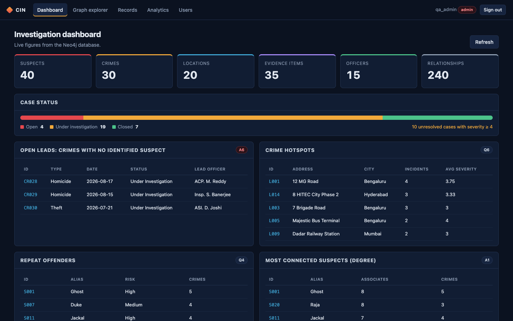

# Criminal Investigation Network

A graph-based investigative intelligence system built on **Neo4j**, with a REST API (Node.js/Express) and a web
interface (React). Course project for **BCSE302P – Database Systems Lab**.

Suspects, crimes, locations, evidence and officers are stored as nodes; the associations between them are typed,
directional relationships with properties. Questions such as *"how is suspect A connected to suspect B?"* or
*"which suspects form a syndicate?"* are answered by traversing the graph instead of joining tables.



## Contents
1. [Problem and objectives](#1-problem-and-objectives)
2. [Architecture and technology](#2-architecture-and-technology)
3. [Graph data model](#3-graph-data-model)
4. [Schema: constraints and indexes](#4-schema-constraints-and-indexes)
5. [Dataset](#5-dataset)
6. [Queries and analytics](#6-queries-and-analytics)
7. [Security: authentication and authorisation](#7-security-authentication-and-authorisation)
8. [Installation and start-up](#8-installation-and-start-up)
9. [Web interface](#9-web-interface)
10. [REST API](#10-rest-api)
11. [Tests and verification](#11-tests-and-verification)
12. [Known limitations](#12-known-limitations)
13. [Demonstration](#13-demonstration)

## 1. Problem and objectives

Investigations are about *connections*: who knows whom, which crimes share evidence, which person links two
groups. In a relational schema every hop is a join, and "connected within 4 steps" queries become expensive and
hard to write. A property graph stores the connections themselves.

Objectives:
* model the investigation domain as a property graph with constraints and indexes;
* full CRUD for every node label and relationship type, with validation and transactions;
* at least ten investigative Cypher queries, verified against an independent reference implementation;
* graph analytics: shortest paths, centrality (degree, PageRank, betweenness) and community detection
  (Louvain, Neo4j Graph Data Science);
* a responsive web interface with interactive graph exploration;
* authentication with role-based authorisation of destructive operations.

## 2. Architecture and technology

```
 Browser (React 19 + Cytoscape.js)          one origin: http://localhost:3000
        │  fetch /api/...  (Authorization: Bearer <token>)
        ▼
 Express API (Node 22) ── auth.js: scrypt passwords, HMAC-signed tokens, role check per request
        │  routes: entities · relationships · cases (transactions) · analytics · graph · gds · auth
        │  only whitelisted labels/types reach the query text; every value is a Cypher parameter
        ▼
 Neo4j 5 (+ Graph Data Science 2.x plugin)  ◄── Python scripts: generate · setup · reference · verify
```

| Layer | Technology |
|---|---|
| Database | Neo4j 5.x (tested on 5.26 Community in Docker), Graph Data Science 2.13 plugin |
| API | Node.js ≥ 20.19 (tested on 22.20), Express 4, neo4j-driver 5 |
| Web | React 19, Vite 7, TypeScript 5.9, Cytoscape.js 3.33 |
| Scripts | Python 3.9+ with the `neo4j` driver |
| Tests | `node:test` + supertest, Neo4j's Cypher linter, live integration tests, Puppeteer (headless Chrome) |

The API serves the built web interface, so there is a single origin and no CORS configuration.
`createApp(db)` receives the database handle, so the same app runs against Neo4j or an in-memory test double.

Repository layout:

```
data/              generated CSV files (5 node files, 6 relationship files)
db/                01_schema · 02_load_unwind / 02_load_csv · 03_crud · 04_queries · 05_indexes
                   06_transactions_cypher_shell.txt · 07_gds · 99_reset
scripts/           generate_data.py · setup_db.py · reference.py · verify.py · cypherfile.py
api/src/           app.js · server.js · auth.js · db.js · schema.js · validate.js · queries.js · routes/
api/test/          unit tests (test double + Cypher linter) and live/ integration tests
web/src/           api.ts · App.tsx · pages/ · components/       web/e2e/ui.e2e.cjs (browser test)
demo/demo_api.sh   scripted API walkthrough        docs/          DEMO.md, screenshots/
PROJECT_LOG.md     activity log of the final implementation phase (commands run, results, decisions)
```

## 3. Graph data model

| Node label | Key (unique) | Main properties |
|---|---|---|
| `Suspect` | `suspect_id` (S001) | first_name, last_name, alias, date_of_birth, gender, risk_level, status |
| `Crime` | `crime_id` (CR001) | type, date, status, severity (1-5), description |
| `Location` | `location_id` (L001) | address, city, zipcode, latitude, longitude, area_type |
| `Evidence` | `evidence_id` (E001) | type, description, collection_date, custody_status |
| `Officer` | `badge_number` (B1201) | name, rank, department, contact_info, years_of_service |

| Relationship | Pattern | Properties |
|---|---|---|
| `KNOWS` | (Suspect)–(Suspect), treated as undirected | connection_type, since, strength (0-1) |
| `COMMITTED` | (Suspect)→(Crime) | role, certainty_score, charged |
| `OCCURRED_AT` | (Crime)→(Location) | time_of_day, witness_count |
| `LINKED_TO` | (Evidence)→(Crime) | relevance_score, processing_status |
| `INVESTIGATING` | (Officer)→(Crime) | assigned_date, lead_investigator |
| `FOUND_AT` | (Evidence)→(Location) | found_by, found_on |

Application accounts are stored as `:User {username, password_hash, role, created_at}` nodes. They are never
connected to the investigation graph and are excluded from every count and graph view.

The single definition of labels, keys, properties and allowed values is [api/src/schema.js](api/src/schema.js);
the web forms are generated from it through `GET /api/schema`.

## 4. Schema: constraints and indexes

[db/01_schema.cypher](db/01_schema.cypher), applied by `setup_db.py` (idempotent):

| Kind | Name | Notes |
|---|---|---|
| Unique (×6) | `suspect_id_unique`, `crime_id_unique`, `location_id_unique`, `evidence_id_unique`, `officer_badge_unique`, `user_username_unique` | each creates a backing range index |
| Existence (×2) | `crime_type_exists`, `suspect_name_exists` | **Enterprise Edition only**, skipped with a warning on Community (the API still requires these fields) |
| Range (×4) | `crime_type_idx`, `crime_date_idx`, `suspect_risk_idx`, `location_city_idx` | |
| Relationship | `committed_certainty_idx` on `COMMITTED.certainty_score` | |
| Text | `suspect_alias_text` on `Suspect.alias` | CONTAINS / ENDS WITH |
| Full-text | `case_text_search` on `Crime|Evidence.description` | used by query A5 |

`verify.py` checks with `EXPLAIN` that the queries in [db/05_indexes.cypher](db/05_indexes.cypher) actually use
`NodeUniqueIndexSeek`, `NodeIndexSeek`, `NodeIndexSeekByRange`, `NodeIndexContainsScan` and
`DirectedRelationshipIndexSeekByRange`. The live tests check that every constraint and index exists and is ONLINE.

## 5. Dataset

`scripts/generate_data.py` writes a reproducible synthetic dataset (fixed random seed; all data is fictitious):
**140 nodes, 240 relationships** (40 suspects, 30 crimes, 20 locations, 35 evidence, 15 officers; 60 KNOWS,
45 COMMITTED, 40 LINKED_TO, 35 INVESTIGATING, 30 OCCURRED_AT, 30 FOUND_AT).
It is built with known structure so that the analytics can be checked: three syndicates
(A = S001–S010 narcotics, B = S011–S019 fraud, C = S020–S029 street gang) with brokers **S001, S011, S020**,
a few bridges between them, and unaffiliated individuals (S030–S040).

`setup_db.py` loads it with `MERGE`, so running it again does not duplicate anything; `--reset` deletes the
investigation data first (user accounts are kept). `db/02_load_csv.cypher` is the same loader for Neo4j Browser.

## 6. Queries and analytics

All queries are parameterised; the API runs only these predefined queries and never accepts Cypher from a client.

**Investigative queries** ([db/04_queries.cypher](db/04_queries.cypher)), verified row by row against
[scripts/reference.py](scripts/reference.py), an independent plain-Python implementation:

| | Question |
|---|---|
| Q1 | Full profile of a suspect: crimes, associates, evidence |
| Q2 | Shortest association path between two suspects (`shortestPath`) |
| Q3 | Everyone within three degrees of a suspect |
| Q4 | Repeat offenders |
| Q5 | Evidence linked to more than one crime |
| Q6 | Crime hotspots |
| Q7 | Chain of custody of an evidence item |
| Q8 | Officer workload and closure rate by department |
| Q9 | Crime trend by quarter |
| Q10 | Suspects linked to a crime only through an associate |
| A1 | **Degree centrality**: most connected suspects (pure Cypher) |
| A2 | Co-offender pairs and whether they are recorded associates |
| A3 | Network reachable only through strong ties |
| A4 | All equally short routes (`allShortestPaths`) |
| A5 | Full-text case search |
| A6 | Open leads: crimes with no identified suspect |
| V1, V2 | Visual: two-hop case context, whole association network (Graph explorer / Neo4j Browser) |

**Shortest path as a graph**: `GET /api/graph/path?from=&to=&via=knows|any` uses `shortestPath()` over KNOWS ties
(suspects only) or over every relationship type (any two records). It returns ordered nodes and edges, 404 for an
unknown id and `found: false` when no path exists within 10 hops.

**Graph Data Science** ([db/07_gds.cypher](db/07_gds.cypher), `GET /api/gds/:algorithm`). Each request creates an
in-memory Cypher projection with a unique name: all `Suspect` nodes and their `KNOWS` ties, undirected, with
`strength` as a property. It runs one algorithm and always drops the projection afterwards.

| Algorithm | GDS procedure | Meaning here | Checked result on this dataset |
|---|---|---|---|
| Louvain | `gds.louvain.stream` (weighted by strength) | communities = likely syndicates | syndicate A (S001–S010) is always one community; 8 communities incl. 3 isolated suspects |
| PageRank | `gds.pageRank.stream` | tied to other well-connected suspects | S020, S001, S011 lead |
| Betweenness | `gds.betweenness.stream` | brokers on shortest paths between others | top 3 are exactly the planted brokers S020, S011, S001 |

Louvain is not fully deterministic: the loosely connected suspects can move between communities from run to run,
while the syndicate structure stays the same. `GET /api/gds/status` reports whether the plugin is installed; without
it the GDS endpoints return 503 and say so (degree centrality, A1, still works). No other algorithm is presented as
Louvain, PageRank or betweenness.

## 7. Security: authentication and authorisation

* **Passwords**: hashed with **scrypt** (Node's built-in `crypto`, N=2^14, r=8, p=1, 16-byte random salt per
  user). Only `scrypt$salt$hash` is stored, and no response ever contains it. Unknown usernames cost the same
  scrypt work as wrong passwords, and both return the same 401 message.
* **Tokens**: after sign-in the API returns `base64url({sub, role, exp}).HMAC-SHA256` signed with `AUTH_SECRET`,
  valid for `TOKEN_TTL_HOURS` (default 8). It is sent as `Authorization: Bearer …`. A token whose role or expiry
  was edited fails the signature check.
* **Brute force**: 10 failed sign-ins for the same IP and username lock that combination for 15 minutes (429).
* **Roles** (enforced on the server for every `/api` request in one place, `authorize()` in
  [api/src/auth.js](api/src/auth.js)):

  | Role | Allowed |
  |---|---|
  | viewer | all reads (GET): records, graph, analytics, GDS |
  | investigator | viewer + create/update (POST, PATCH): records, relationships, cases, lead reassignment |
  | admin | investigator + **all deletes** (DELETE) + user management |

  Self-registration (`POST /api/auth/register`) creates a *viewer*. The first admin is created at API start-up from
  `ADMIN_USERNAME` / `ADMIN_PASSWORD`; admins promote other accounts on the **Users** page.
  The web interface hides controls a role cannot use, but the server makes every decision itself. A viewer who
  sends a DELETE directly gets 403, and this is tested.
* **Input**: every body and query value is validated against `schema.js`. Labels, relationship types and traversal
  depth come only from whitelists, and all values are Cypher parameters (no string-built Cypher from user input).
* **Errors**: 500 responses contain no internal details; driver errors are logged on the server only.
* **Browser**: the token is kept in `sessionStorage` (cleared when the tab closes, never in a URL). The API sends
  `Content-Security-Policy: default-src 'self'` (no third-party or inline scripts), `X-Frame-Options: DENY` and
  `nosniff`. React escapes all rendered data.
* **Secrets** live only in `.env` (git-ignored). [.env.example](.env.example) contains placeholders.

Limitations: tokens are stateless, so a role change or account deletion takes effect at the next sign-in (at most
`TOKEN_TTL_HOURS`). There is no sign-out-everywhere. The login lock-out counter is in memory, per API process.
HTTPS must be provided by a reverse proxy in a real deployment.

## 8. Installation and start-up

**Prerequisites:** Node.js ≥ 20.19 (22 LTS recommended), Python 3.9+, and **either** Docker Desktop **or**
Neo4j Desktop.

### 8.1 Neo4j with the Graph Data Science plugin

Option A: Docker (what this project was tested with):
```bash
cp .env.example .env            # then set NEO4J_PASSWORD, AUTH_SECRET, ADMIN_PASSWORD
docker run -d --name cin-neo4j -p 7474:7474 -p 7687:7687 \
  -e NEO4J_AUTH="neo4j/<the NEO4J_PASSWORD from .env>" \
  -e NEO4J_PLUGINS='["graph-data-science"]' -e NEO4J_dbms_security_procedures_unrestricted='gds.*' \
  -v cin-neo4j-data:/data neo4j:5.26-community
# later: docker start cin-neo4j   /   docker stop cin-neo4j
```
Option B: Neo4j Desktop. Create a local 5.x DBMS, then *Plugins → Graph Data Science Library → Install*, and
start it. Put its password in `.env`.

### 8.2 Configuration (`.env` in the repository root)

| Variable | Purpose |
|---|---|
| `NEO4J_URI`, `NEO4J_USER`, `NEO4J_PASSWORD`, `NEO4J_DATABASE` | database connection |
| `PORT` | API and web port (default 3000) |
| `AUTH_SECRET` | token signing key, ≥ 32 random characters (`openssl rand -hex 32`); if missing a random one is used per start |
| `TOKEN_TTL_HOURS` | token lifetime (default 8) |
| `ADMIN_USERNAME`, `ADMIN_PASSWORD` | first administrator, created at start-up if absent (password ≥ 8 characters) |

### 8.3 Load the data, build, run

```bash
pip install -r requirements.txt
python3 scripts/setup_db.py           # expected ending: TOTAL: 140 nodes, 240 relationships -> SUCCESS
python3 scripts/verify.py             # expected: 21 passed, 0 failed

cd api && npm install && cd ..
cd web && npm install && npm run build && cd ..
cd api && npm start                   # http://localhost:3000  (web UI + API under /api)
```
Open http://localhost:3000 and sign in with `ADMIN_USERNAME` / `ADMIN_PASSWORD`.

For UI development with hot reload, run `npm run dev` in `web/` (http://localhost:5173, proxies `/api` to port 3000).

## 9. Web interface

| Page | What it does |
|---|---|
| Sign in / Register | sign in; registration creates a read-only viewer |
| Dashboard | live counts per label and relationships, case status, open leads (A6), hotspots (Q6), repeat offenders (Q4), most connected (A1) |
| Graph explorer | interactive Cytoscape graph. *Neighbourhood* of any id (1 or 2 hops) or *Whole network* (140 nodes). Label/type filters, zoom, fit, re-layout. Click a node for its properties and connections; *Expand neighbours* pulls more of the graph in |
| Records | the five labels: search (any property), enum filters, pagination, details, create / edit (forms from the schema), delete (admin, with the 409 "has relationships" flow), add / delete relationships |
| Analytics | shortest path (drawn as a path), GDS Louvain (graph coloured by community), PageRank / betweenness (ranked, node size by score), the query library Q1–A6 with validated parameters |
| Users (admin) | change roles, delete accounts |

Screenshots of the running application are in [docs/screenshots](docs/screenshots).

## 10. REST API

All endpoints except register and login need `Authorization: Bearer <token>`. Minimum role: GET = viewer,
POST/PATCH = investigator, DELETE = admin.

| Method | Path | Purpose |
|---|---|---|
| POST | `/api/auth/register` · `/api/auth/login` | create a viewer account · obtain a token |
| GET | `/api/auth/me` | current user and token expiry |
| GET · PATCH · DELETE | `/api/auth/users` · `/api/auth/users/{username}` | list · change role · delete (admin) |
| GET | `/api/health` · `/api/schema` | counts · graph model for forms |
| GET | `/api/{entity}` | list: `?q=` text search, filters such as `?risk_level=High`, `?limit=`, `?skip=` |
| GET | `/api/{entity}/{id}` | one node plus a summary of its relationships |
| POST · PATCH · DELETE | `/api/{entity}` · `/api/{entity}/{id}` | create (duplicate key → 409) · partial update (key immutable) · delete (409 while relationships exist unless `?detach=true`) |
| GET · POST · PATCH · DELETE | `/api/relationships/{TYPE}` | list `?from=&to=` · create/update with body `{from, to, properties}` · delete `?from=&to=` |
| GET | `/api/graph` · `/api/graph/node/{id}?depth=1\|2` · `/api/graph/path?from=&to=&via=` | graph data `{nodes, edges}` for the explorer |
| GET | `/api/analytics` · `/api/analytics/{Q1..A6}` | query catalogue · run a query; query-string values override its parameters |
| GET | `/api/gds/status` · `/api/gds/{louvain\|pagerank\|betweenness}` | GDS availability · run an algorithm |
| POST | `/api/cases` | register a whole case in **one ACID transaction** |
| PATCH | `/api/cases/{crime_id}/lead` | reassign the lead investigator atomically |
| POST | `/api/demo/rollback` | explicit transaction: begin → write → fail → rollback |

`{entity}` ∈ `suspects, crimes, locations, evidence, officers`; `{TYPE}` ∈ `KNOWS, COMMITTED, OCCURRED_AT,
LINKED_TO, INVESTIGATING, FOUND_AT`.

Sample requests:
```bash
TOKEN=$(curl -s -X POST localhost:3000/api/auth/login -H 'Content-Type: application/json' \
  -d '{"username":"admin","password":"<ADMIN_PASSWORD>"}' | python3 -c 'import json,sys;print(json.load(sys.stdin)["token"])')
curl -s -H "Authorization: Bearer $TOKEN" 'localhost:3000/api/graph/path?from=S002&to=S026'   # 5 hops
curl -s -H "Authorization: Bearer $TOKEN" localhost:3000/api/gds/betweenness                  # S020, S011, S001 first
curl -s -H "Authorization: Bearer $TOKEN" 'localhost:3000/api/suspects?q=ghost'              # S001
```
`bash demo/demo_api.sh` walks through the whole API (it signs in with the admin account from `.env`).

## 11. Tests and verification

Each kind of check is listed separately, because they prove different things:

| Command | Needs | What it proves | Result (2026-10-12) |
|---|---|---|---|
| `cd api && npm test` | nothing | routes, validation, auth/roles, transaction boundaries and error mapping against an **in-memory test double**; every Cypher statement (scripts and API-generated) passes **Neo4j's Cypher linter** | 41 passed |
| `python3 scripts/verify.py` | Neo4j + data | Q1–A6 executed **on Neo4j** equal the independent Python reference; index operators in query plans | 21 passed |
| `cd api && npm run test:live` | Neo4j + data + GDS | the real API on the **real database**: schema objects, auth, CRUD, transactions/rollback, shortest path, Louvain/PageRank/betweenness with ground-truth checks. Uses temporary records and removes them | 16 passed |
| `cd web && npm run build` | nothing | TypeScript type check and production build | OK |
| `cd web && E2E_USER=<admin> E2E_PASSWORD=<pw> npm run test:e2e` | running app + Chrome | 35 UI checks in **headless Chrome**: sign-in, dashboard, graph explorer, records CRUD, relationships, analytics, GDS, viewer restrictions, mobile layout, no console errors | 35 passed |
| `AUTO=1 bash demo/demo_api.sh` | running app | scripted API walkthrough | all steps returned expected statuses |

## 12. Known limitations

* Existence constraints need Neo4j Enterprise Edition. On Community (the tested Docker image) they are skipped
  and the API's validation enforces the same rules.
* GDS features need the plugin. Without it the API reports `available: false` and returns 503 for the three
  algorithms; nothing is replaced by a different algorithm.
* Louvain is not fully deterministic for weakly connected suspects (see section 6).
* Tokens are stateless (a role change or deletion applies at the next sign-in); the login lock-out is per process.
* The graph explorer's *Whole network* view renders the full dataset (140 nodes). That is fine at this size, but a
  much larger database would need server-side paging (the endpoint already supports `limit`).
* The production JS bundle is ~680 kB (most of it Cytoscape). This is acceptable for a local application and has
  not been split.
* No HTTPS termination (use a reverse proxy in a real deployment).

## 13. Demonstration

Step-by-step demo script with sample inputs, expected outputs and a fallback plan: **[docs/DEMO.md](docs/DEMO.md)**.

All data in this repository is fictitious.
